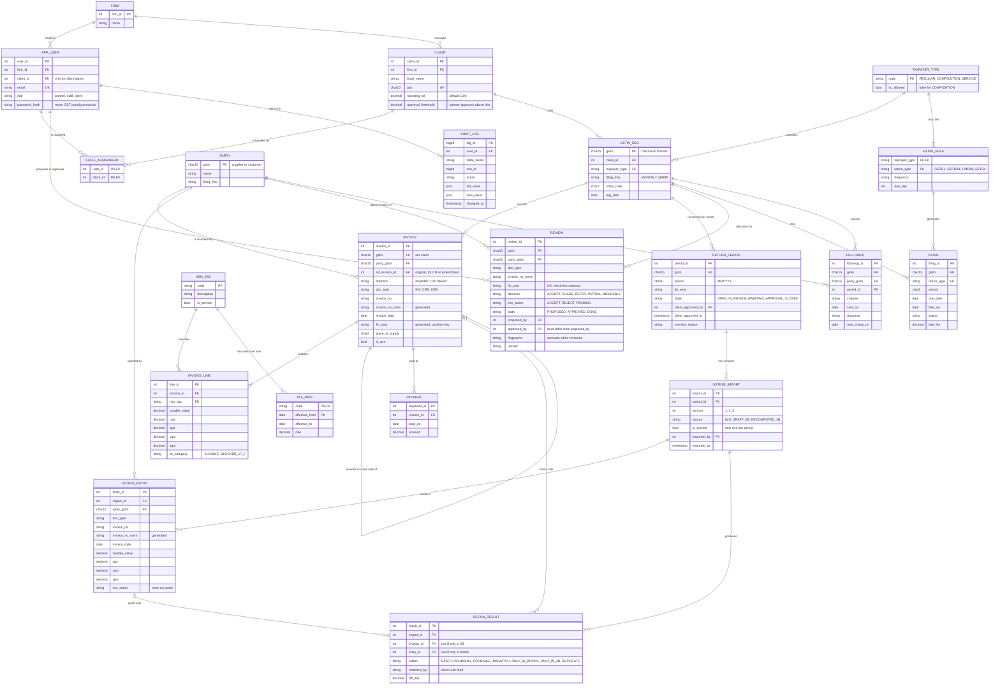
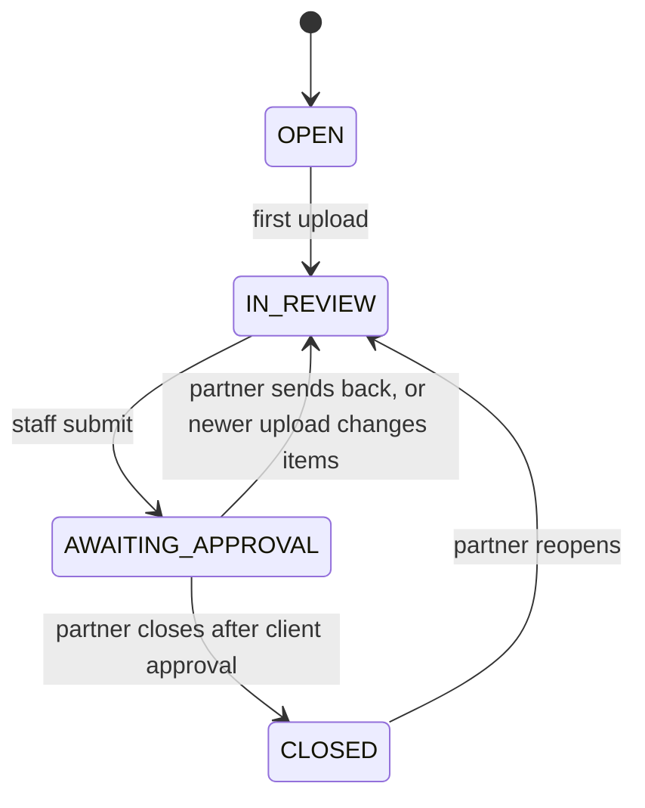
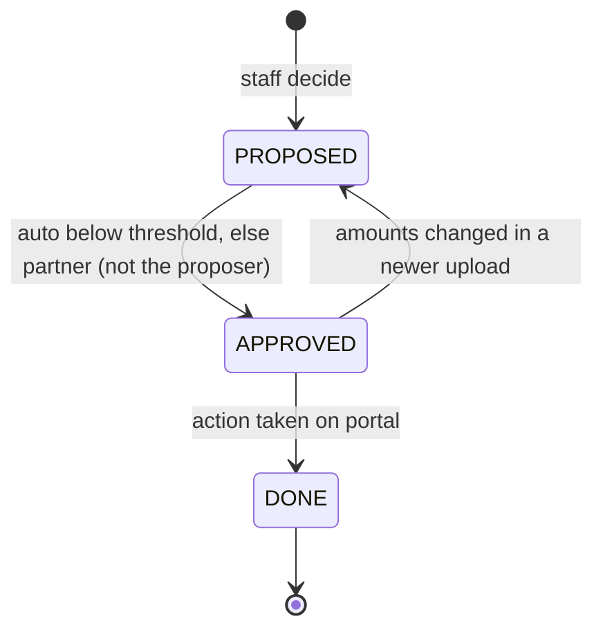

# ER Diagram (v2: the middle version)

v2 replaces the 29-entity draft. It starts from the simple ITC Guard model (17 entities) and adds back only the pieces that fix a real problem in the user flow. The result is **21 entities in 4 groups**. Everything else is a view, a column or a trigger.

## The 60-second explanation for the professor

1. **Who:** a CA firm has users and clients. Each client has one or more GSTINs, and each GSTIN has a taxpayer type that decides what it may do. Composition dealers get no ITC. Staff see only the clients assigned to them.
2. **What the client recorded:** invoices with lines. Each line has an HSN/SAC code, and rates are looked up by date, never hard-coded. Suppliers are parties. Payments are recorded against invoices.
3. **What the government shows:** every GSTR-2B upload is a numbered version of that month. Each run of the matcher compares the books with one version and writes results.
4. **What people decided:** a review belongs to a **real invoice** (supplier, type, number, year), not to a row in one upload. Re-uploading 2B or moving to next month never loses work. Filings and follow-ups track deadlines and suppliers.

## Diagram

## What v2 adds to the simple model, and why

These are the 6 additions. Each one fixes a problem the simple model can't handle.

| Added | Problem it fixes | One line for the viva |
|---|---|---|
| `STAFF_ASSIGNMENT` | The simple model has no way to restrict staff | "Row-level security reads this table: staff only see assigned clients." |
| `TAXPAYER_TYPE` | The type was a free-text string, so rules couldn't reference it | "`itc_allowed = false` for composition, and a trigger blocks ITC using it." |
| `GSTR2B_IMPORT` | Re-uploading 2B after the 14th would overwrite or duplicate entries | "Every upload is a version. One is current, enforced by a partial unique index." |
| `REVIEW` | The simple `RECON_RESULT.status` mixes the machine's verdict with the human decision, and is lost on re-run | "Results are rebuilt each run. Reviews are keyed by the real invoice, so they survive re-uploads and carry into next month automatically." |
| `FILING_RULE` | The calendar had no rules about who files what | "Composition files CMP-08 and GSTR-4, regular files GSTR-1 and 3B. Filings are generated from this table." |
| `FOLLOWUP` | Supplier chasing left no evidence | "Who chased which supplier, when, how, and what they replied." |

## What v2 removes from the simple model, and why

| Removed | Replaced by | Reason |
|---|---|---|
| `ITC_LEDGER` table | View `v_itc_ledger` | Available, claimed and blocked amounts can be computed from invoices and reviews. Storing them creates update anomalies. **"We don't store what we can derive."** |
| `ALERT` table | View `v_alerts` | Alerts come from due dates and open reviews. |
| `PARTY.filing_score` | Materialized view `mv_party_score` | It's a derived aggregate, refreshed on demand. |
| `RECON_RESULT.match_score` | `matched_by` (rule name) | A rule name is explainable. A made-up score isn't. |

## What the 29-entity draft had that v2 folds away

| v1 entity | Where it went in v2 |
|---|---|
| `invoice_identity` | Gone. `REVIEW` uses the five natural-key columns directly. |
| `item_decision` + `carried_from` chain | Gone. One `REVIEW` row per real invoice lives across months, so carry-forward needs no extra table. |
| `client_settings` | Columns on `CLIENT` |
| `client_user` | `APP_USER.client_id` |
| `client_approval` | Columns on `RETURN_PERIOD` |
| `period_transition` | A trigger with the allowed moves in a CASE statement |
| `match_rule`, `match_difference` | `RECON_RESULT.matched_by` and `diff_tax` |
| `followup_item`, `job_queue`, `state_code` | Out of the ER: generated letter text, infrastructure, and a CHECK constraint respectively |
| `pr_document` + `sales_summary` | One `INVOICE` table with `direction`, which makes liability possible later |

## Rules the database enforces

- **Composition dealers get no ITC.** A trigger rejects an `INWARD` invoice line with `itc_category = ELIGIBLE` when the GSTIN's `taxpayer_type.itc_allowed = false`. It also refuses reconciliation for that GSTIN.
- **Place of supply.** A CHECK constraint enforces: same state as the GSTIN means CGST+SGST, otherwise IGST.
- **Rates by date.** The line's rate must equal the `TAX_RATE` row valid on `invoice_date`. A mismatch shows as a warning.
- **One-to-one matching.** `UNIQUE (import_id, invoice_id)` and `UNIQUE (import_id, entry_id)`.
- **One current upload.** A partial unique index on `GSTR2B_IMPORT (period_id) WHERE is_current`.
- **Maker-checker.** `CHECK (approved_by <> proposed_by)`. Approval is required above `CLIENT.approval_threshold`.
- **Month states.** `OPEN → IN_REVIEW → AWAITING_APPROVAL → CLOSED`, plus a partner-only reopen. A trigger blocks a close without client approval or an override reason.
- **Changed since review.** A view compares `REVIEW.fingerprint` with the current result's amounts. Nothing extra is stored.
- **Append-only audit.** No role can UPDATE or DELETE `AUDIT_LOG`.
- **Partitioning.** `INVOICE`, `INVOICE_LINE`, `GSTR2B_ENTRY` and `AUDIT_LOG` are partitioned by `fin_year`.

## State machines

